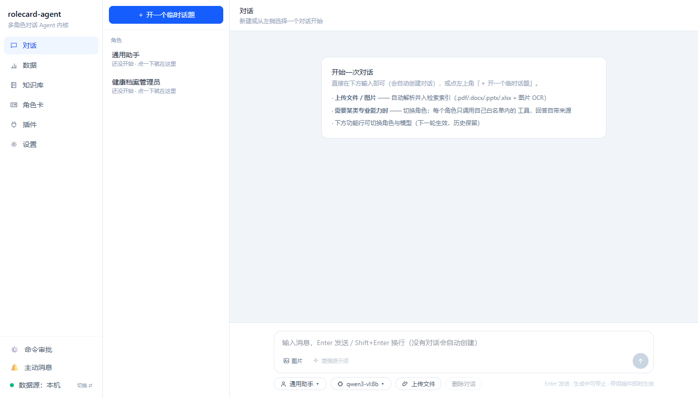
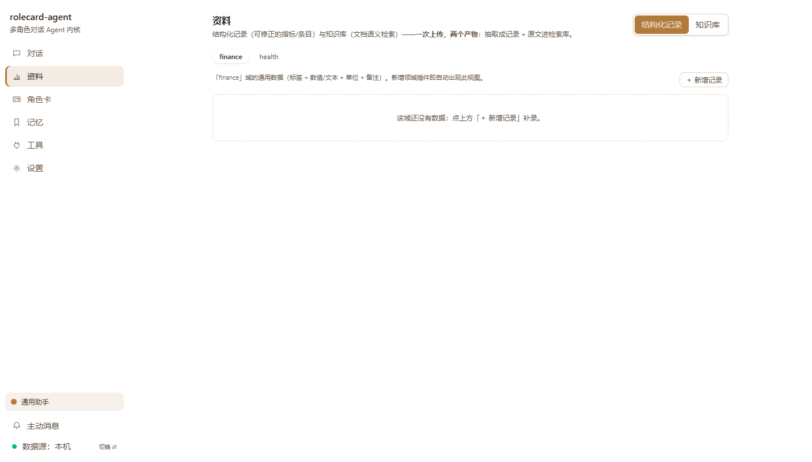
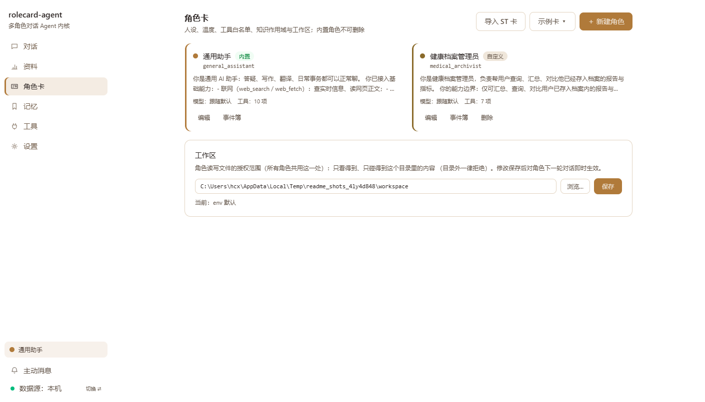
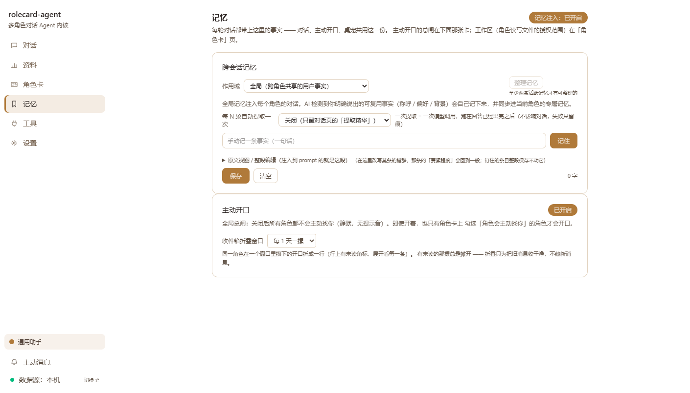
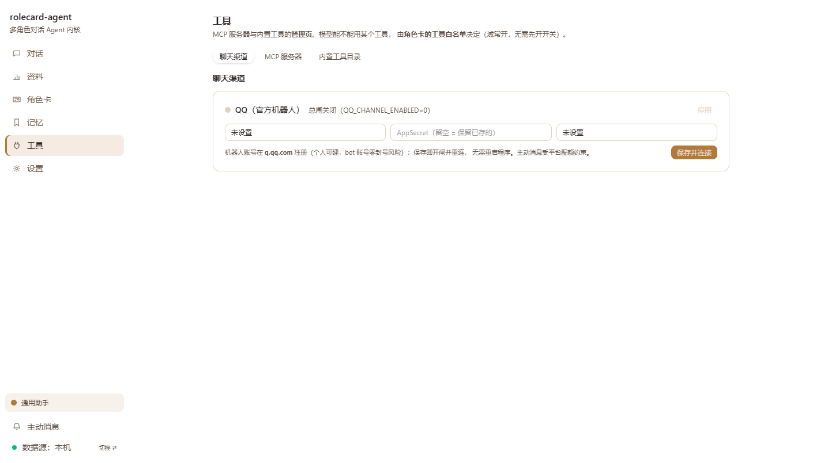
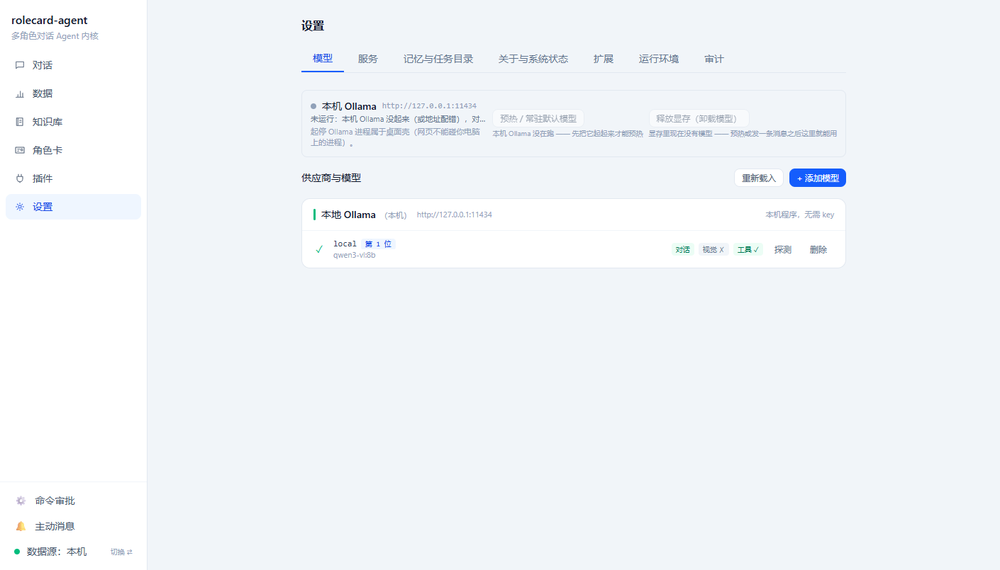
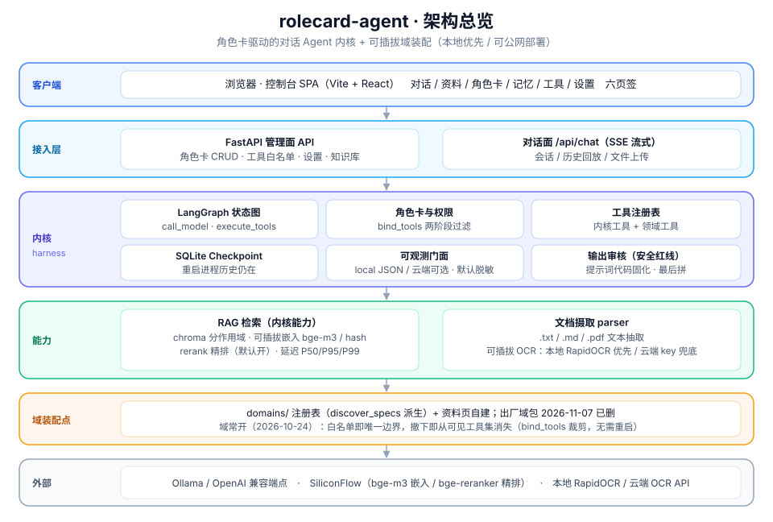

# rolecard-agent

[](https://github.com/HCX0426/rolecard-agent/actions/workflows/ci.yml)
[](https://github.com/HCX0426/rolecard-agent/releases)

[](docs/gate-readings.json)

**本地优先的角色卡 Agent 运行时**：人设即配置、工具与知识可插拔、数据不出机器。
一张角色卡声明人设、示例对话、可用工具白名单与知识范围，运行时热切换且历史不丢；
领域能力由使用者自建并显式注册。本地 Ollama 或任意 OpenAI 兼容云端皆可驱动，
带 Web 控制台与桌面壳，可一键公网部署。
门禁现值见 [docs/gate-readings.json](docs/gate-readings.json)（自动写入，本页不抄数字）。

- **人设即配置**：角色卡声明人设、示例对话、可用工具白名单与知识范围；运行时切换，历史不丢。
- **工具与知识可插拔**：领域插件显式注册，**域常开、角色卡的工具白名单即唯一边界**（2026-10-24 权限模型收口后的口径）；RAG 检索作为内核工具挂载。
- **本地优先**：默认对接 Ollama（`qwen3-vl:8b`，8GB 显存可跑）；数据全部落在本地 SQLite + Chroma。
- **可靠抽取**：上传报告自动走 schema 约束 + 确定性校验 + 原文锚定 + 第二模型交叉验证，
  只有两模型一致的项才入库，其余进「待确认」由人裁决。
- **可辩护的工程纪律**：文档与代码不同步这件事由机器盯着，不靠自觉（见「工程纪律」一节）。

---

## 快速开始

**只想看看它长什么样？** Windows 上双击 `install.bat`（自动建 venv、装依赖、建表），
再双击 `start.bat`，浏览器打开 `http://127.0.0.1:8000/` 即可对话。
不装 Ollama 也是完整可用的一等形态 —— 在「设置」页加一个 OpenAI 兼容后端即可。

**要完整走一遍（含门禁与开发依赖）：**

```bash
# 1. 环境（Python ≥ 3.13）
python -m venv .venv
.\.venv\Scripts\python.exe -m pip install -U pip

# 2. 依赖（锁安装：requirements/requirements.lock 覆盖全部运行时族，pip-compile 从 requirements/ 下的
#    五份镜像产出；改了它们要重新 compile，lockfile parity 尺子盯着）
.\.venv\Scripts\python.exe -m pip install -r requirements/requirements.lock

# 3. 本地模型（可选 —— 不装 Ollama 也是完整可用的一等形态，
#    在设置页加一个 OpenAI 兼容后端即可；数据不出机器的边界由默认本地后端承担）
ollama pull qwen3-vl:8b

# 4. 配置
copy .env.example .env

# 5. 建表 + 初始化内置角色
.\.venv\Scripts\python.exe scripts/init_db.py

# 6. 一致性自检（文档与代码是否同步，退出码可用于 CI）
.\.venv\Scripts\python.exe scripts/check_consistency.py

# 7. 提交钩子（每台克隆机一次性：pre-commit 的 ruff 三连 + dist 重建拦截靠它挂载）
git config core.hooksPath .githooks

# 8. 启动（控制台 + 流式对话）
.\.venv\Scripts\python.exe scripts/run_api.py
#    打开 http://127.0.0.1:8000/ —— 新建会话即可对话；换端口用环境变量 RUN_API_PORT
```

> 默认角色「通用助手」带基础内核工具（联网、工作区文件读写、多模型比对、知识库检索），
> 刻意不接领域工具；领域能力在资料页自建域、再把对应工具勾进角色白名单。出厂域包与域角色
> 已随 2026-11-07 删除，默认常驻只有通用助手（2026-10-31 拍板，域角色仅 `--seed-domain-roles` 显式种）。
> 改了前端再构建：`cd frontend && npm ci && npm run build`（普通演示不需要 node，dist 已入库）。
> 开发态三件套（后端 + 前端热更新 + 桌面壳一条命令）：`powershell -NoProfile -File scripts/dev.ps1`。
> 类 Unix：`python3 -m venv .venv && . .venv/bin/activate && pip install -r requirements/requirements.lock`；
> Windows 上也可双击根目录的 `install.bat` 一键装机。

---

## 界面预览

控制台六个页签（**2026-10-30 IA**，页签唯一出处见 `frontend/src/App.tsx` 的 TABS 注册表）：
**对话**（过程）· **资料**（领域数据 + 知识库区块）· **角色卡**（人格与权限 + 工作区）·
**记忆**（跨会话事实 + 主动开口）· **工具**（内置工具目录 + MCP + 聊天渠道）· **设置**（环境与凭据）。
（截图 2026-10-30 随 IA 重排重拍；重拍工具：`scripts/tools/render_readme_shots.py`）

| 对话 | 资料（领域数据 + 知识库区块） | 角色卡（含工作区） |
| --- | --- | --- |
|  |  |  |

| 记忆（跨会话事实 + 主动开口） | 工具（内置工具目录 + MCP + 聊天渠道） | 设置（模型热切换 + 回退链） |
| --- | --- | --- |
|  |  |  |

---

## 部署

**Docker**（dist 已入库，镜像里没有 node；以非 root 运行，带 HEALTHCHECK）：

```bash
docker build -t rolecard-agent .
docker run -p 8000:8000 -v rolecard-data:/app/data \
  -e AUTH_MODE=on -e AUTH_CREDENTIALS=<user>:<pass> rolecard-agent
```

> 镜像绑 0.0.0.0，而「非回环 + 无鉴权」是**拒绝启动**的硬护栏 —— 公网部署必须显式给鉴权。
> 容器形态不带本地 OCR（按设计裁剪）：需要 OCR 时在「服务」页配云端端点。

**公网（TLS + 域名）**：`docker-compose.yml` + `deploy/Caddyfile` 已就绪 —— 证书归 Caddy、
应用不直接暴露端口。四样环境变量：`ROLECARD_DOMAIN`（解析到这台机器的域名）、
`ROLECARD_CREDENTIALS`（`operator:you:<长密码>`，带前缀才有管理面）、可选
`SILICONFLOW_API_KEY` 与 `ROLECARD_RATE_LIMIT`；完整验证步骤见 `docker-compose.yml` 顶部注释。

**桌面壳**：`shell/` 是 Electron 桌宠壳，`npm run package` 打出随包后端的 NSIS 安装包
（GitHub Release 提供成品）。

---

## 架构一页



<sub>分层：客户端 → 接入层 → 内核 harness → 能力（RAG / 文档摄取）→ 域装配点 → 外部依赖。
核心约束：`core/` 内不出现任何领域专有名词（机器校验）；检索是内核能力，领域只声明作用域；
工具经「域在注册清单 → 角色白名单」两阶段过滤后才 bind 给模型 —— 看不到即调不到。</sub>

**域开发**只需三步：在 `domains/<name>/` 实现 `models.py` / `service.py` / `tools.py` /
`schema.sql`，包的 `__init__.py` 导出 `SPEC`（`discover_specs()` 目录枚举自动派生，缺声明启动即报错），
初始化时装载 schema（新域不必改清单，但**要重打 sidecar** 才进安装包）。边界不变式不变：不做界面
动态安装；运行时域集合绝不暴露给模型；能力只经角色卡工具白名单生效，「启停」的现役语义就是从白名单撤工具。

---

## 工程纪律

这一节想说明的是**约束由机器守着**，而不是文档里写着一句「要保持同步」。

- **规模**：`git ls-files` 实算四桶约 15.3 万行 —— 业务代码约 4.0 万、测试约 5.0 万、
  前端源码约 3.7 万、门禁与取证脚本约 2.6 万（**业务代码只占约 26%**）。
- **一致性核查**：`scripts/check_consistency.py` 是 90 条自定义断言，
  每次 push 与本地每次提交都跑（退出码可用于 CI）。它守的是「文档与代码不同步」这件事本身：
  文档链接可达、版本号四处一致、读数不进散文、依赖方向不倒挂、能力矩阵与实际路由对得上。
- **依赖方向**：`import-linter` 机器校验分层不被绕过。`core/` 内不出现任何领域专有名词，
  这条同样由断言盯着，不是靠 code review 的自觉。
- **覆盖率三档**：全局 90% / 单文件 85% / 改动行 95% —— 三把尺子各有盲区且互不重叠，
  所以三档并存。阈值只有一个出处（`pyproject.toml`），三份活文档抄它，抄错当场红。
- **AI 辅助开发的边界**：本仓大量使用 AI 编程工具（Codex）生成代码 —— 这一点写在最前面，
  因为它是这个仓库工作方式的一部分，不是需要藏起来的事。分工是：**架构决策、门禁设计、
  边界取舍由人定**（本页的每条「为什么」都是人写的）；AI 负责按这些约束写实现；
  人做验证 —— 90 条断言、覆盖率三档与依赖契约就是「AI 写的代码也逃不出这三张网」的落地形态。
  一条约束有没有机器在守，比一段代码是谁写的更值得问。
- **一条判断标准**：一条约束有没有机器在守。如果它只写在文档里，那它迟早漂；
  有断言盯着，它才是真约束。反过来，**一条只会绿的检查比没有检查更糟** —— 它给你虚假的安心。

---

## 关键设计决策

只列**能讲清取舍与代价**的几条，细节在 `docs/架构总览.md`。

| 决策 | 选择 | 代价 |
| --- | --- | --- |
| 工具权限怎么收口 | 在 `bind_tools` **之前**按角色白名单裁剪工具表，未授权工具对模型完全不可见 | 白名单是唯一边界，因此换角色必须重建工具表 —— 用 `tool_epoch` 代际号兜住跨版本恢复 |
| 用不用 LangGraph | 用：检查点现成、步数上限是图的一部分、状态合并语义有明确契约 | 它的 async checkpointer 不适用（`SqliteSaver` 的 async 版会抛 `NotImplementedError`），所以内核刻意做成同步 |
| 内核同步还是异步 | 同步 | 长任务占线程；换来的是编排层没有隐藏的 await 边界 |
| 流式用 SSE 还是 WebSocket | SSE：单向为主，走普通 HTTP，天然穿透代理、自动重连 | 只能服务端推，所以「停止生成」走另一条 HTTP 端点而不是复用同一条流 |
| 领域能力怎么扩 | `domains/<name>/` 自建 + `SPEC` 显式注册，目录枚举自动派生 | 新域要重打 sidecar 才进安装包；换来的是「运行时域集合绝不暴露给模型」这条不变式成立 |
| 覆盖率的度量 | 三档并存（全局 / 单文件 / 改动行） | 门禁步骤更多；换来的是「只看全局均值」看不见的局部退化照样拦得住 |

---

## 已知边界（已验证 vs 未验证）

这一节刻意写得保守 —— 能跑和能扛量级是两件事。

**已在本机验证**：一键装依赖 + 建表 + 起服务的完整链路；90 条一致性断言本机实跑通过；
前后端 dist 与源码同步；命令执行审批的一次性令牌；路径穿越三重收敛；上传解压双闸；
限流与来源标识护栏；健康探活与深度探活分离。

**未验证 / 尚未关闭**（不因为写在这里就变成做完了）：

- **公网部署的「第一次真跑」**：证书真签下来、429 真返回、403 真挡住，需要一台有域名的机器。
  配置面（`docker-compose.yml` + `deploy/Caddyfile`）已就绪，且有一条断言把旋钮与护栏钉在一起，
  但那台机器上的第一次运行仍然开着。
- **Postgres checkpointer 的并发表现**：未实测。当前是单机 SQLite 全局锁，多进程部署需要换方案。
- **嵌入模型效果对比**：未实测（TF-IDF 词法降级路径已实现并可跑）。
- **多用户 / 并发 / 多租户隔离**：没做。这不是「生产可用」的形态 ——
  一个工程纪律完整的**单用户本地 Agent**。

---

## 里程碑

| # | 内容 | 状态 |
| --- | --- | --- |
| **M1** | 对话内核：状态图、按角色 bind_tools、SQLite 检查点、可观测 | ✅ |
| **M2** | 角色卡 CRUD + 插件启停（tool_epoch 实时生效；2026-10-24 收口后现役口径=角色工具白名单，`/api/plugins` 端点已退役）+ 两阶段工具过滤 + 审计 | ✅ |
| **M3** | 领域插件（health 档案：结构化查询 / 对比 / 报告检索；出厂域包 2026-11-07 已删，域改为用户自建） | ✅ |
| **M4** | FastAPI 接入层 + SSE 流式对话 + 聊天 UI | ✅ |
| **M5** | 控制台前端工程化（六页签，dist 由 FastAPI 托管） | ✅ |

v2 系列：RAG 检索（v2.1）、文档摄取与可插拔 OCR（v2.2）、前端完善（v2.3）已落地；
公网部署面已写好（见上），生产化替换（Postgres/Milvus/Redis，v2.5）未开始。

---

## 质量与运维

- **门禁**：ruff + mypy（含 Linux 档）+ 后端 pytest + 前端 vitest + 一致性核查（90 条断言：
  依赖方向、文档链接、能力矩阵、路由访问分级…），全部离线；覆盖率阈值 90%（`pyproject` 单源）。
  现值见 [docs/gate-readings.json](docs/gate-readings.json)（门禁自动写入，本页不抄数字）。
- **安全边界**：路径穿越三重收敛、上传解压双闸、XFF 伪造链防护、命令执行审批（一次性令牌）、
  限流、来源标识护栏；密钥只写不回读，凭据不进审计与日志。
- **运维接口**：`/api/health`（免鉴权探活，编排器用）与 `/api/health/deep`（真依赖逐项，
  operator 凭据）刻意分开；`/api/metrics` 输出 Prometheus 文本（只数事件名，不含用户文本）。
- **依赖**：锁安装（`requirements/requirements.lock`，镜像住 `requirements/`），
  `pyproject.toml` 是唯一事实来源；OCR 依赖独立 venv。

---

## 文档

| 文件 | 内容 |
| --- | --- |
| [`docs/README.md`](docs/README.md) | **全部文档的登记处**（含新人阅读顺序与术语表入口） |
| [`docs/架构总览.md`](docs/架构总览.md) | 单一事实源：定位/双壳 · 技术栈 · 模块地图 · 关键不变式 · 安全模型 |
| [`docs/需求与验收标准.md`](docs/需求与验收标准.md) | PRD、用户故事、评测集设计、v1/v2 边界 |
| [`docs/前端设计.md`](docs/前端设计.md) | 前端分层/组件约定 · IA · 深色/响应式 |
| [`docs/开发流程.md`](docs/开发流程.md) | 设计先行四步 + 门禁分层用法 + 提交约定 |
| [`docs/架构审计索引.md`](docs/架构审计索引.md) | 历史审查台账的编号索引（含归档件） |
| [`CONTRIBUTING.md`](CONTRIBUTING.md) | 协作规约：铁律、接口契约、错误码、环境准备 |

---

## 免责声明

本项目为技术学习与工程实践作品，演示数据全部虚构。
系统设计上禁止输出任何疾病诊断、用药建议或治疗方案，仅对已入库档案数据做汇总与查询。
AI 自动提取的指标默认标记为「未经人工校验」，不构成任何医疗建议。
